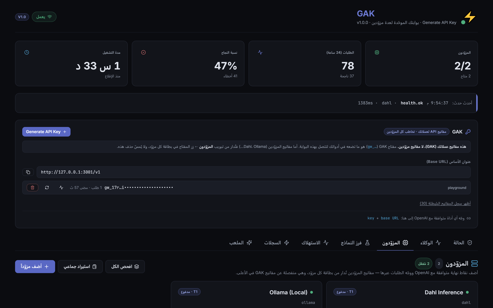
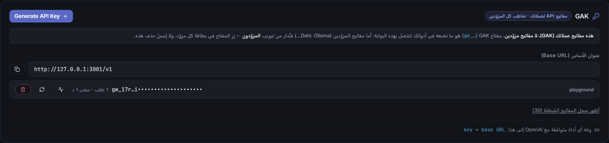
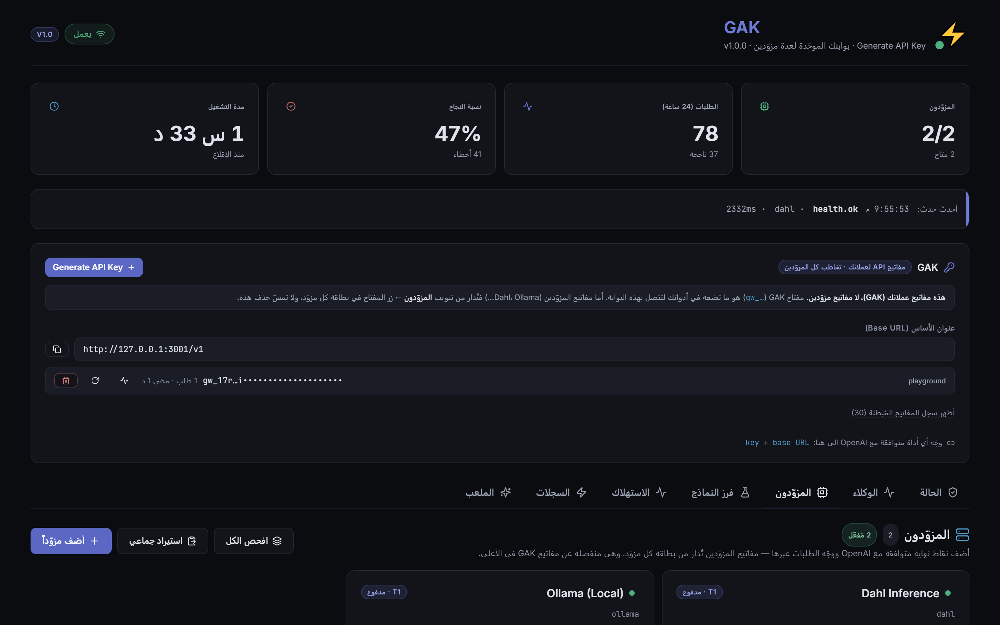
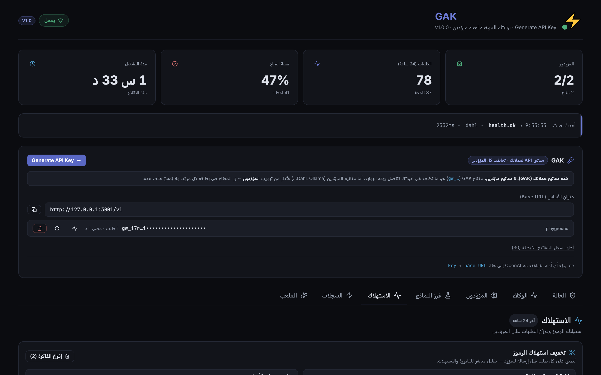
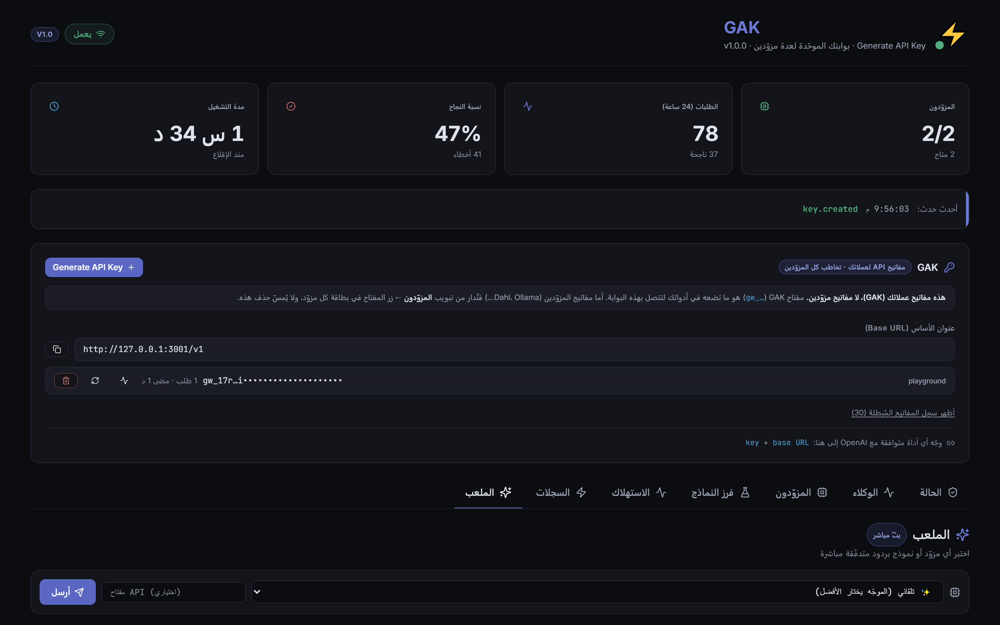
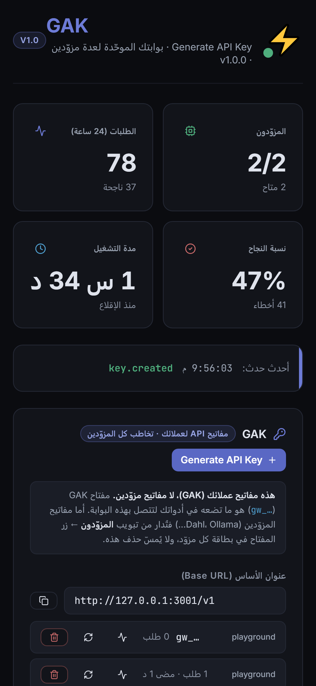

# GAK — Production AI Gateway

**GAK** (Generate API Key) is a unified multi-provider AI gateway with a real-time web
dashboard, streaming chat, and automatic failover. One endpoint, one key for every tool.



## Features

- **OpenAI-compatible API** at `/v1/chat/completions`
- **Anthropic-compatible API** at `/v1/messages` (works with Claude Code and the Anthropic SDK)
- **38 ready presets** in the catalog (`server/catalog.yaml`) — one click in the dashboard adds any of them; whatever you enable lives in `server/providers.yaml`, and this checkout ships with exactly one (`dahl`)
- **One key for everything** — point any OpenAI-compatible tool at one URL
- **Multiple keys per provider** — paste ten keys for one source and the gateway rotates them: a
  quota-exhausted key is isolated on its own and the next one is tried instantly, all silently
- **Bulk import** — paste all your keys at once; the provider is detected from the key's prefix
- **Model probe** — sends a real chat call per model, rejects the dead ones and hides them from routing
- **Health monitoring** + automatic failover on two levels (key → provider)
- **Token saving** — tool-output trimming, context window, `max_tokens` ceiling, and a response cache
- **Per-key usage stats** (tokens, models, latency, activity chart) — including streamed requests
- **Tool calling** (`tools` / `tool_choice`) forwarded end-to-end
- **SQLite** event log + usage tracking
- **Modern UI** (React + Vite + Tailwind)

## Quick Start

```bash
# 1. Install
cd ai-gateway-web-v2
npm install

# 2. Add API keys (optional — gateway works with keyless providers too)
# Edit .env or server/providers.yaml
echo "GROQ_API_KEY=your_key" > .env
echo "DEEPSEEK_API_KEY=your_key" >> .env
echo "OPENROUTER_API_KEY=your_key" >> .env

# 3. Run dev mode (server + web)
npm run dev

# 4. Open browser
# http://localhost:5173
```

The API server runs on `:3001`, the web UI on `:5173` (proxies `/api` and `/ws` to backend).

## Configuration

Everything below is optional — the gateway runs with defaults.

| Variable | Default | Purpose |
|---|---|---|
| `PORT` | `3001` | API server port |
| `HOST` | `127.0.0.1` | Bind address. Set `0.0.0.0` to expose on the network |
| `CORS_ORIGINS` | local dev origins | Comma-separated list of allowed origins |
| `ADMIN_TOKEN` | *(empty)* | If set, every `/api/*` route requires it. Exchanged once for an **HttpOnly cookie** via `POST /api/auth` (tools may also send `X-Admin-Token`) |
| `TRUST_PROXY` | *(empty)* | Set `1` when behind nginx/caddy so rate limits key on the real client IP |
| `ALLOW_UNAUTHENTICATED_API` | *(empty)* | Set `1` only if your reverse proxy already authenticates the dashboard — otherwise a proxied deployment without `ADMIN_TOKEN` keeps `/api` closed (503) |
| `WS_MAX_CLIENTS` | `50` | Max concurrent dashboard WebSocket connections |
| `API_KEY_PREFIX` | `gw_` | Prefix for generated client keys |

### Where provider API keys actually live

**Provider keys are stored in the SQLite database (`provider_keys` in `data/gateway.db`), not in
`.env`.** This is what makes multiple keys per provider work: each key is its own row with its own
status, quota window and request counter.

`.env` holds **only environment-level settings** — `ADMIN_TOKEN`, `HOST`, `PORT`, `CORS_ORIGINS`.
It is never the source of truth for provider credentials.

> **Backing up** — copy `data/gateway.db` (it contains your keys). A backup of `.env` alone will
> restore your settings but **not** your provider keys.

A `<PROVIDER>_API_KEY` variable is still read **once at first boot** as a convenience: if a provider
has no keys in the database yet, its env var is imported and then lives in the database. After that
the database wins, and editing a key in the dashboard writes to the database — never back to `.env`.

Only env names that map to a **known provider** (the catalog or `providers.yaml`) are imported.
Anything else ending in `_API_KEY` is reported and ignored, so an unrelated variable can never
become a phantom provider key.

If you set `ADMIN_TOKEN`, open the dashboard once with `?token=YOUR_TOKEN` — the server
exchanges it for an **HttpOnly cookie** (unreachable from page scripts, hardened against
XSS token theft) and the token never lands in `localStorage`. Tools and scripts can
authenticate with the `X-Admin-Token` header as before.

### Client keys are hashed, shown once

Gateway keys (the ones your tools use) are generated with `crypto.randomBytes` and stored
**only as a SHA-256 hash** in the database — a leaked `gateway.db` backup does not leak
your client keys. The full value is displayed exactly once, at creation/regeneration;
afterwards the dashboard shows a fingerprint (`gw_ab…wxyz`). Regenerate to rotate.

> **Exposing on your network** — if you set `HOST=0.0.0.0` the server warns loudly and refuses to
> start unless `ADMIN_TOKEN` is set. Without it, any device on the same Wi-Fi can read your keys and
> delete your providers.

## Dashboard tabs



The strip above is the whole idea: generate a **GAK** key once, hand it to your tools, and it
reaches every provider you have enabled. GAK keys and provider keys are two separate domains and
never mix.

| Tab | What it is for |
|---|---|
| **Providers** | Add, edit, enable/disable and test providers. API keys are written **encrypted to the database** (`data/gateway.db`). |
| **Model sort** | The single question: *which models actually work?* Sends a real chat call to each model, lists them in one flat filterable table, and automatically blocks the dead ones from routing. |
| **Usage** | Token consumption per provider (last 24h). |
| **Logs** | Live event stream (chat, health, provider changes). |
| **Playground** | Streaming chat to test any model, with quick-connect details. |

<p align="center">
  
  
</p>

<p align="center">
  
  
</p>

Regenerate these with the server running: `node scripts/screenshot.mjs`.

In **Model sort**, the four KPI cards are clickable filters, the provider strip filters by provider,
and the table is searchable and sortable. A model marked *rejected* is hidden from `/v1/models` and
never retried until you re-probe it or clear the results.

## Testing

```bash
npm test             # offline guards: security, crypto, modules, agents, routing, web
npm run test:ui      # jsdom UI e2e (needs the server running: npm run dev)
npm run test:api     # full API battery (every route + negative cases + WebSocket)
npm run test:tasks   # browser tasks: full user journeys (isolated instance)
npm run test:browser # full browser battery (all tabs/buttons; destructive — use an isolated instance)
npm run test:browser:safe  # same battery, read-only (BASE=http://127.0.0.1:3001)
npm run test:live    # live security checks against GATEWAY_URL
npm run test:prod    # full production e2e (real provider call, needs a key in .env)
npm run test:console # React/console warnings per component (needs the server)
npm run test:decrypt # verifies stored keys decrypt with the local credential key
```

> **Browser/API batteries with a real provider** — the live-chat and probe checks read test keys
> from `data/.testkeys.json` (`{"dahl": ["…"]}`, gitignored — never commit real keys). Without it,
> those checks are skipped honestly and everything else still runs.

`tests/ui.e2e.tsx` renders the real components in jsdom and drives them against the live API — it
covers the add/edit provider modal (save, prefill, error surfacing) and the Model sort tab
(render, KPIs, table, search, filtering, method explainer).

## Architecture

```
ai-gateway-web/
├── server/              # Express + WebSocket backend
│   ├── index.ts         # main entry + all HTTP routes (/v1, /api, probe suite)
│   ├── provider.ts      # OpenAI-compatible client
│   ├── router.ts        # routing + failover + probe-rejection blocklist
│   ├── probe.ts         # model probe engine (real chat call + error classification)
│   ├── provider-manager.ts  # YAML read/write, connection test, model fetch
│   ├── config.ts        # YAML + .env loader
│   ├── db.ts            # SQLite (events, usage, api_keys, model_probe)
│   └── providers.yaml   # provider config (no secrets)
├── data/gateway.db      # SQLite database
├── src/                 # React frontend
│   ├── App.tsx          # main shell
│   ├── components/      # tabs (Providers, Model sort, Usage, Logs, Playground)
│   ├── lib/             # api client + utils
│   └── index.css        # Tailwind
├── tests/               # jsdom UI tests (not part of the build)
└── package.json
```

## Production Build

```bash
npm run build           # builds to dist/
npm start               # runs the server, which also serves dist/
```

The server serves `dist/` automatically when that folder exists (with SPA fallback for deep
links), so a single process is enough for a unified deploy. `npm run dev` keeps using Vite's dev
server with hot reload and proxies `/api`, `/v1` and `/ws` to the backend.

## API Usage

Any OpenAI-compatible client can point at `http://localhost:3001/v1`:

```bash
# Streaming chat
curl http://localhost:3001/v1/chat/completions \
  -H "Content-Type: application/json" \
  -d '{"model":"auto","messages":[{"role":"user","content":"Hello"}],"stream":true}'

# List all available models
curl http://localhost:3001/v1/models
```

Use with coding agents:
```bash
export OPENAI_BASE_URL=http://localhost:3001/v1
export OPENAI_API_KEY=any
claude -p "your task"
```

## Management API

| Method | Path | Purpose |
|---|---|---|
| POST | `/v1/chat/completions` | OpenAI-compatible chat (streaming, tools, vision) |
| POST | `/v1/messages` | Anthropic-compatible chat (Claude Code, Anthropic SDK) |
| POST | `/v1/embeddings` | Embeddings passthrough to the first provider that serves the model |
| GET | `/v1/models` | Unified model list — includes `auto` and hides probe-rejected models |
| GET | `/api/status` | Providers, stats, usage, drift snapshot |
| GET | `/api/providers` | All providers with status, `enabled` and key counts |
| POST | `/api/providers/add` | Add a provider (its key is stored in the database) |
| PATCH | `/api/providers/:id` | Edit name/url/tier/models/key (`apiKey: "__clear__"` removes all keys) |
| POST | `/api/providers/:id/toggle` | Enable/disable a provider (persisted to YAML) |
| DELETE | `/api/providers/:id` | Remove the provider (its DB keys are kept; `?purgeKeys=1` deletes them too) |
| GET | `/api/providers/:id/keys` | List that provider's keys (masked) + summary |
| POST | `/api/providers/:id/keys` | Add one or many keys `{"keys":["…","…"]}` |
| PATCH | `/api/providers/:id/keys/:keyId` | Rename · disable · replace value · `{"reactivate":true}` |
| DELETE | `/api/providers/:id/keys/:keyId` | Remove a key |
| GET | `/api/catalog` | The provider catalog + key-prefix patterns |
| POST | `/api/providers/import` | Bulk import (`{"text":"…","dryRun":true}` for a preview) |
| GET/PATCH | `/api/settings` | Token-saving settings (cache, trimming, ceilings) |
| GET | `/api/probe/results` | Stored probe results + summary |
| POST | `/api/probe/:id/model/*` | Probe one model (real chat call) |
| POST | `/api/probe/:id/all?cap=N` | Probe every model of one provider |
| POST | `/api/probe/everything?cap=N` | Probe all enabled providers |
| POST | `/api/probe/retry-rejected` | Re-probe only previously rejected models |
| DELETE | `/api/probe/results` | Clear probe results and unblock rejected models |
| GET | `/api/usage` | Token usage per provider (last 24h) |
| GET/POST/DELETE | `/api/keys…` | Client key management (list = fingerprints; create/regenerate returns the full value **once**) |

## Multiple keys per provider

Free tiers are per account, so ten keys for one source is ten times the quota. Each key has its own
state, and isolation moved from the provider down to the key:

- **429** → that key alone is parked for 5 minutes, the next key is tried immediately
- **401/403** → that key is marked invalid and the next one is tried
- **All keys exhausted** → only then does the gateway move to the next provider

Exhausted keys are *parked, not deleted* — quotas usually reset, so one click reactivates them.
Keys live in the SQLite database (`provider_keys`), never in `providers.yaml` and never in `.env`.

## Automatic provider enablement

Providers do not need to be switched on by hand. On every startup the gateway reconciles them: a
provider that has **a usable key, at least one model, and no active block** is enabled automatically
and written back to `providers.yaml` as `enabled: true`.

A provider stays off only when there is a real reason:

| Stays off because | Fix |
|---|---|
| No usable key (none configured, or every key is invalid/disabled) | Add a key on the Providers tab |
| Marked `auth_error` | Fill in a working key for that provider |
| Parked after a quota or outage | Nothing — it re-enables itself once the park expires |
| `autoEnable: false` set in `providers.yaml` | Deliberate opt-out; remove the flag to rejoin |

Two consequences worth knowing. First, adding a key to a provider that was off is enough — it comes
online at the next start, with no toggle. Second, if you switch a provider off in the UI *and* you
want it to stay off, add `autoEnable: false`, otherwise the next restart turns it back on.

## Probe classification

Each model probe returns one of six states. The distinction between the last two matters most:

| State | Meaning | Blocked from routing? |
|---|---|---|
| `ok` | Replied to a real chat call | no — and preferred when picking `auto` |
| `rejected` | Model is gone or does not support chat | **yes** |
| `provider_auth` | The provider's **key** failed (401/403) — the model was never really tested | **no** |
| `rate_limited` | Quota or a transient network failure | no |
| `slow` | No reply in time, or a transient server error | no |
| `no_key` | Provider has no key configured | no |

`provider_auth` is deliberately **not** a block. A single dead key used to mark every model of that
provider as rejected — 112 models of one provider were once blocked by one bad key. Auth failures
now mark the *key*, never the model.

Rejected results also expire (24h), so a provider that comes back is not blocked forever. The
hourly auto-probe re-tests transient states continuously and rejected states every 6 hours.

Databases written before this classification existed are **repaired automatically on startup**: any
`rejected` row whose stored error text is an auth failure (`Invalid API key`, `Unauthorized`,
`authentication_error`, …) is moved to `provider_auth`. The migration is idempotent — it does nothing
once the data is clean — and it logs how many rows it moved, so an upgrade needs no manual SQL.

## Bulk import

Open **Providers → استيراد جماعي** and paste. Any of these formats work:

```
AIzaSy…                 ← key alone: the provider is detected from the prefix
groq=gsk_…              ← provider=key (for ambiguous keys like sk-…)
openrouter: sk-or-v1-…  ← provider: key
{"provider":"deepseek","key":"sk-…"}
```

Use **معاينة** (dry run) first — it shows what each line resolves to and flags the ones needing
attention, without writing anything.

Only **enabled** providers that have a key (or are keyless) take part in routing. Models the probe
rejected are hidden from `/v1/models` and skipped during routing, so a dead model is never retried.

## Saving tokens

**Usage → تخفيف استهلاك الرموز**:

| Setting | What it does |
|---|---|
| Response cache | Identical request → cached reply, zero upstream tokens (TTL configurable) |
| Tool-output trimming | Old `tool` messages are truncated — usually 70–90% of a coding agent's tokens |
| Context window | Keep the system prompt + the last N messages (orphan tool calls are cleaned up) |
| `max_tokens` ceiling | Hard cap per request, whatever the client asks for |

Settings are persisted in the database. Trimming never touches the last three tool outputs, so the
recent context stays intact.

## الوكلاء (إشراف ذاتي التشغيل)

الخادم يراقب نفسه ويصلح نفسه: يجلب المفاتيح من مصادرها، يدوّرها، يعزل ما مات —
ويسجّل **كل** تغيير في سجل تدقيق. قراراته مكتوبة كقواعد محدَّدة، لا استدلال.

### هرمية المصادر (الأصغر يفوز)

| الأولوية | المصدر | التهيئة |
|---|---|---|
| 10 | HashiCorp Vault (KV v2) | `VAULT_ADDR` + `VAULT_TOKEN` |
| 20 | Doppler | `DOPPLER_TOKEN` |
| 30 | 1Password Connect | `OP_CONNECT_HOST` + `OP_CONNECT_TOKEN` + `OP_VAULT_ID` + `OP_ITEM_ID` |
| 40 | ملف محلي | `data/secrets.json` — `{"groq":"gsk_...","openrouter":["sk-or-a","sk-or-b"]}` |
| 50 | متغيّرات `.env` | أي `*_API_KEY` (يُقرأ من قائمة الكتالوج) |
| 90 | مفتاح يدوي من الواجهة | **لا تمسّه المزامنة إطلاقاً** |

### ثلاث قواعد لا تُخترق
1. **لا حذف تلقائي أبداً** — المفتاح المسحوب يُعطَّل ويُسجَّل، والاسترجاع سطر واحد.
2. **المفتاح اليدوي مقدّس** — لا تسحبه المزامنة ولا تعطّله.
3. **فشل مصدر لا يسحب شيئاً** — انقطاع Vault في السحابة لا يُطفئ مفاتيح الإنتاج.

كل مفتاح له **قاطع دائرة**: `closed` (يعمل) · `open` (معطّل بسبب مكتوب) ·
`half-open` (انتهت المهلة، يُجرَّب). والعزل يتصاعد أسّياً حتى 15 دقيقة.

### المسارات (محمية بـ`ADMIN_TOKEN`، ولا تُعيد أي سرّ)

| المسار | الوظيفة |
|---|---|
| `GET /api/agents/status` | حالة المشرف + دوائر المفاتيح + كل المصادر وحالاتها |
| `POST /api/agents/sync` | مزامنة فورية (نفس دورة الخمس دقائق) |
| `POST /api/agents/rotate` | دورة تدوير فورية |
| `GET /api/agents/keys` | دوائر المفاتيح تفصيلاً (بصمات فقط) |
| `GET /api/agents/audit` | سجل التدقيق: من غيّر ماذا ومتى ولماذا |

### الإعداد
```bash
# فعّل مصدراً واحداً على الأقل (الباقي يُتجاهل تلقائياً)
echo "VAULT_ADDR=https://vault.internal:8200" >> .env
echo "VAULT_TOKEN=..." >> .env

AGENTS_ENABLED=0          # تعطيل كامل للوكلاء (فحص يدوي فقط)
AGENT_SYNC_INTERVAL_MS=300000   # كل 5 دقائق
```

> كل التوكنات تُقرأ من البيئة، ولا تُطبع ولا تُسجَّل. المصادر غير المُهيَّأة
> لا تُستدعى ولا تُحسب فشلاً — يظهر تقريرها `configured: false`.

---

## Providers Included

| ID | Tier | Auth | Enabled by default |
|---|---|---|---|
| apmix | 4 | `APMIX_API_KEY` | yes |
| bluesminds | 4 | `BLUESMINDS_API_KEY` | yes |
| pollinations | 4 | keyless | yes |
| groq | 4 | `GROQ_API_KEY` | no |
| deepseek | 3 | `DEEPSEEK_API_KEY` | no |
| openrouter | 2 | `OPENROUTER_API_KEY` | no |
| zai | 3 | `ZAI_API_KEY` | no |
| google-ai | 3 | `GEMINI_API_KEY` | no |
| ollama | 1 | none (local) | no |
| mistral | 4 | `MISTRAL_API_KEY` | no |
| together | 4 | `TOGETHER_API_KEY` | no |
| cohere | 4 | `COHERE_API_KEY` | no |
| fireworks | 4 | `FIREWORKS_API_KEY` | no |
| cerebras | 4 | `CEREBRAS_API_KEY` | no |
| chutes | 4 | `CHUTES_API_KEY` | no |

Tier is a **priority, not a price**: lower is tried first (1 = highest priority, 4 = free safety
net). Disabled providers stay visible in the dashboard — add the key to `.env`, then switch them
on with the power button.

## License

MIT
